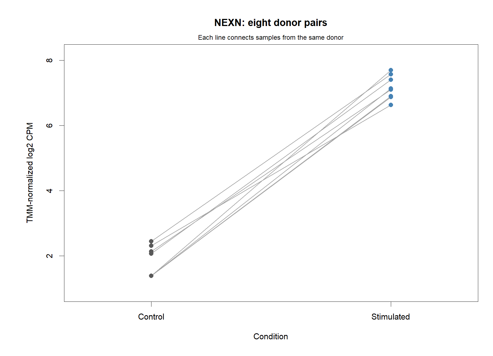

# Paired IFN-beta RNA analysis in CD14-labelled monocytes

**Seema Sharma | Guided R and edgeR portfolio project | Completed analysis: 20 November 2026**

This project analyzes public single-cell RNA-seq data from eight donors with lupus, each represented under control and six-hour IFN-beta-stimulated conditions. It asks how relative RNA profiles in supplied CD14-labelled monocytes differ between conditions while accounting for donor pairing.

Raw counts were summed into **16 donor-condition pseudobulk samples**. The baseline retained **5,355 profiles**, tested **3,697 genes**, and identified **2,506 genes with BH FDR <0.05**: 1,252 higher and 1,254 lower in stimulated samples. Results agreed closely under two selected QC alternatives.

This is a learning and reproducibility project using an existing dataset. Coding, troubleshooting and documentation were AI-assisted. It does not claim a new biological discovery or independent validation.

## Study and interpretation

- Data: `muscData::Kang18_8vs8()`, ExperimentHub record EH2259, GEO GSE96583.
- Loaded object: 35,635 features by 29,065 cell profiles.
- Eight paired donors, not 16 independent people; individual cells are not independent donor replicates.
- Both conditions are from donors with lupus. This is not a lupus-versus-healthy comparison, a clinical trial or a proteomics project.
- The original experiment used a separate pooled preparation for each condition. **Donor blocking cannot separate condition from a shared condition-specific pool effect.** Results are therefore interpreted as study-specific condition associations.

## Workflow

1. Audit donor, condition, supplied cell labels and supplied multiplet flags.
2. Keep 24,679 singlet-labelled profiles, then 5,385 carrying the supplied CD14+ Monocytes label.
3. Inspect count depth, detected genes and unusual globin-rich profiles. Apply a baseline minimum of 200 detected genes, retaining 5,355 profiles.
4. Sum raw counts by donor and condition; verify metadata alignment, totals and all eight pairs.
5. Filter genes with `filterByExpr(group=Condition, min.count=10, min.total.count=15)` and use TMM normalization.
6. Fit edgeR's paired model `~ Donor_ID + Condition` with `glmQLFit(robust=TRUE, legacy=FALSE)`. Test `Conditionstim` and adjust p-values with BH.
7. Inspect MDS, model variability and a donor-paired NEXN display. Repeat the model under two separate QC alternatives.
8. Rerun from the checked script and compare full result tables with the saved analysis.

## Results and sensitivity

| Analysis | Profiles | Genes tested | FDR <0.05 | Higher in stim | Lower in stim |
|---|---:|---:|---:|---:|---:|
| Baseline: >=200 detected genes | 5,355 | 3,697 | 2,506 | 1,252 | 1,254 |
| >=300 detected genes | 5,254 | 3,687 | 2,497 | 1,246 | 1,251 |
| Exclude seven globin-majority profiles | 5,348 | 3,696 | 2,525 | 1,260 | 1,265 |

The globin alternative starts from the baseline and excludes profiles where HBB, HBA1 and HBA2 together contribute >50% of counts. It is separate from the >=300 alternative.

| Agreement with baseline, among shared tested genes | >=300 genes | Globin exclusion |
|---|---:|---:|
| Shared tested genes | 3,687 | 3,696 |
| Spearman correlation of logFC | 0.9999 | 0.9997 |
| Same effect direction | 99.73% | 99.78% |
| FDR <0.05 in both | 2,484 | 2,502 |
| Significant in both with opposite directions | 0 | 0 |

The overall pattern is stable under these two choices. These checks share the same assay, annotations, normalization and model, and do not independently validate those assumptions. A larger number of significant genes is not evidence that an alternative analysis is better.



Each line links donor-condition pseudobulk samples from the same donor. NEXN is higher in stimulated samples in all eight pairs. The display uses TMM-normalized log2 CPM with `prior.count=2`. NEXN was selected after looking at the results; the figure illustrates a finding, rather than independently validating it. The displayed prior-adjusted differences need not equal the model coefficient.

## Rerun the analysis

1. Extract or clone this repository and open `PBMC_IFNB_project.Rproj` in RStudio.
2. If needed, run `source("R/00_install_packages.R")` once to install muscData and edgeR with their dependencies. Installation is optional setup, separate from analysis.
3. Save open work, then use **Session > Restart R**.
4. From the project root run:

```r
source("R/03_rerun_checked.R")
```

The script loads its own data and creates its own objects. It normally reuses the ExperimentHub cache; on a new computer the data must be downloaded. Outputs go to a new `results/rerun_*` folder, leaving the packaged reference results intact.

The recorded successful rerun passed 29 historical checks and matched all three full result tables to their earlier CSVs with a numerical comparison tolerance of `1e-8`. See [reproducibility record](docs/reproducibility.md). This verifies rerun consistency in the recorded environment, not biological truth or identical behavior under all future software versions.

Recorded environment: R 4.6.1, muscData 1.26.0, edgeR 4.10.7 and limma 3.68.5. Exact versions are recorded in `results/tables/software_versions.csv`; full dependencies are in `results/logs/session_info.txt`. There is no environment lockfile. Installing current package versions may produce different results.

`R/01_study_design.R` is an optional design-only learning script. The checked analysis entry point is `R/03_rerun_checked.R`; the exploratory console-era script was consolidated into it.

## Evidence and explanations

- [Methods and limitations](docs/methods_and_results.md)
- [Completed analysis notebook](docs/analysis_notebook.md)
- [How to explain this project](docs/explain_my_project.md)
- [When and what to check](docs/what_to_check_when.md)
- [Figure guide](docs/figure_guide.md)
- [Reproducibility and file provenance](docs/reproducibility.md)
- [Table dictionary](docs/table_dictionary.md)
- [Printable observation guide](docs/PBMC_IFNB_Observation_Guide.pdf)

## Limits to carry forward

- The 13 MT- gene rows were present but all zero in the supplied object, even before singlet filtering. Mitochondrial percentage was uninformative and no mitochondrial threshold was applied. The upstream cause remains unresolved.
- Cell labels were supplied and not independently re-annotated. A small marker review does not validate every profile.
- Supplied genetic multiplet flags can miss same-donor doublets. No ambient-RNA correction was performed.
- The three-globin fraction is a descriptive RNA count fraction, not an estimated contamination fraction or a validated universal cutoff.
- Normalization and model assumptions still matter. Results concern relative RNA abundance, not protein abundance or absolute RNA per cell.
- Fold-change confidence intervals, pathway enrichment, independent donor replication and experimental validation were not performed in this project.

## Sources

- Kang et al. (2018), *Multiplexed droplet single-cell RNA-sequencing using natural genetic variation*: https://doi.org/10.1038/nbt.4042
- Public author manuscript, including pooled experimental design: https://stacks.cdc.gov/view/cdc/79371/cdc_79371_DS1.pdf
- muscData: https://bioconductor.org/packages/release/data/experiment/vignettes/muscData/inst/doc/muscData.html
- GEO: https://www.ncbi.nlm.nih.gov/geo/query/acc.cgi?acc=GSE96583
- edgeR User's Guide: https://bioconductor.org/packages/release/bioc/vignettes/edgeR/inst/doc/edgeRUsersGuide.pdf

The original study produced the data. This repository contains a guided secondary analysis and its records; original data ownership and source terms remain with their respective owners.
